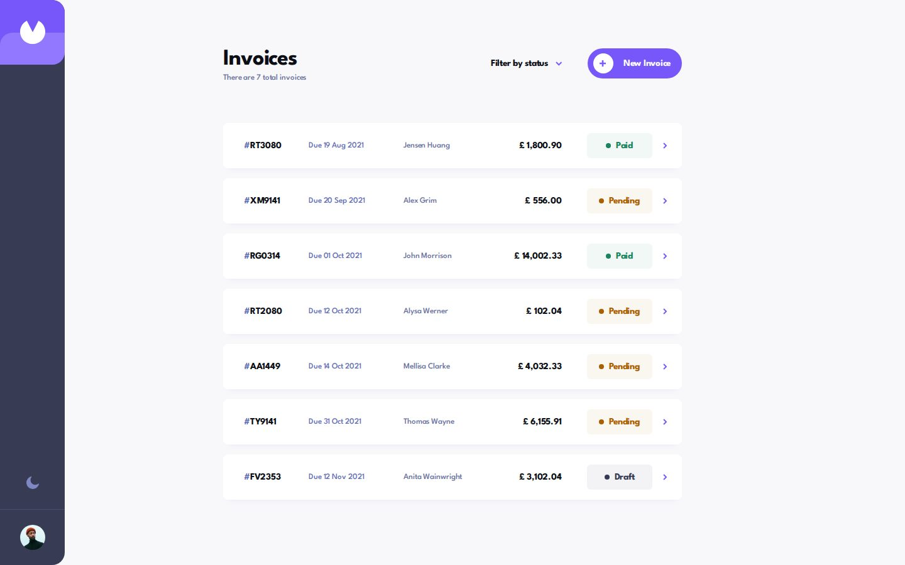
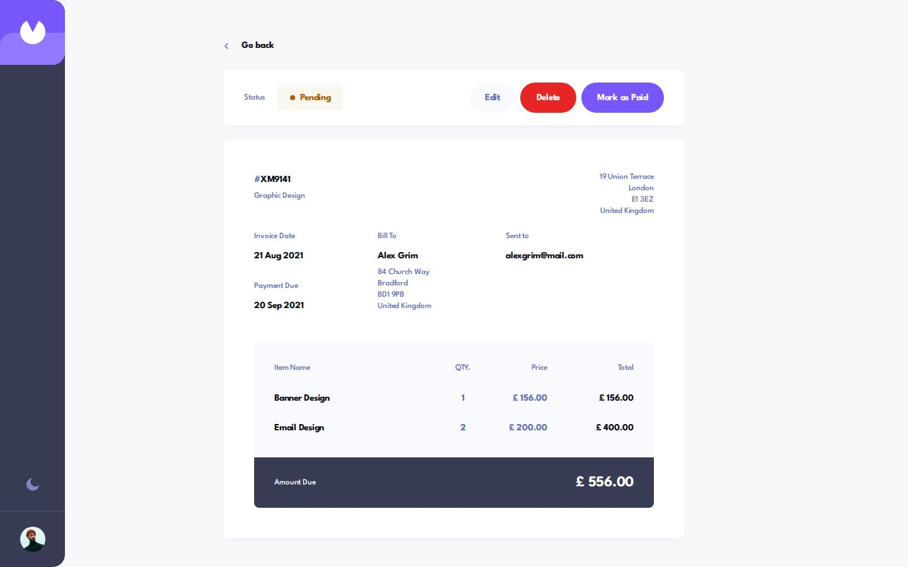
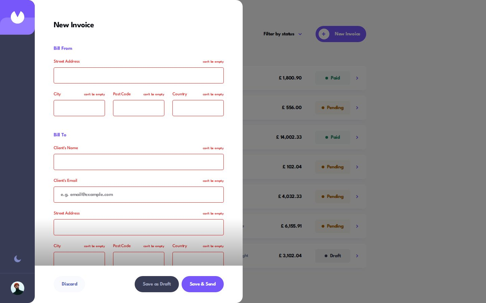
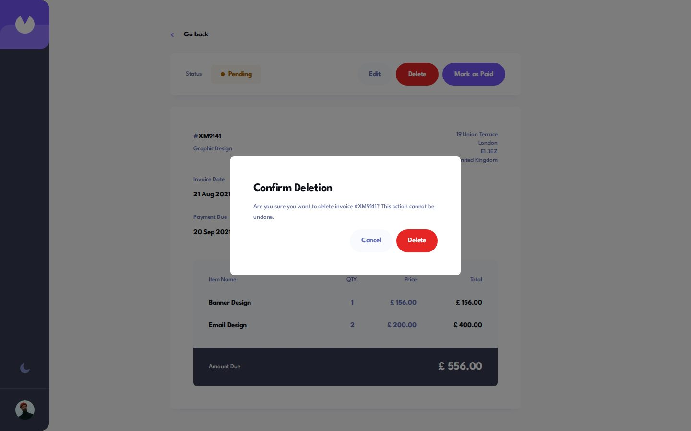
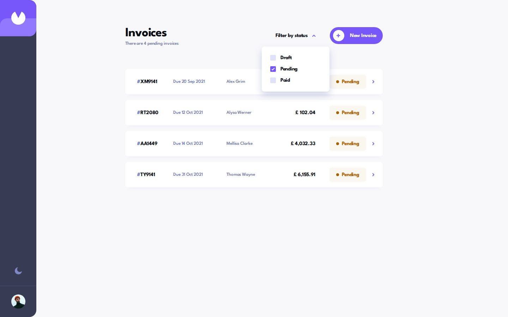
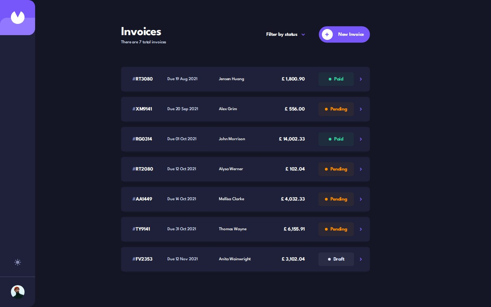
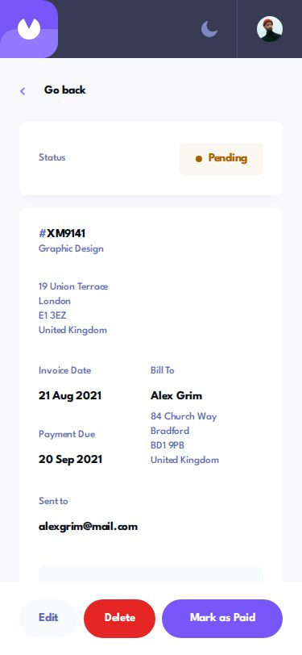
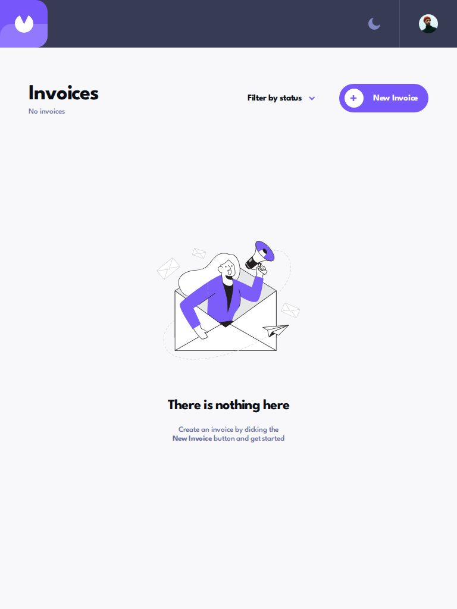

# Frontend Mentor - Invoice app solution

This is a solution to the [Invoice app challenge on Frontend Mentor](https://www.frontendmentor.io/challenges/invoice-app-i7KaLTQjl). Frontend Mentor challenges help you improve your coding skills by building realistic projects.

## Table of contents

- [Overview](#overview)
  - [The challenge](#the-challenge)
  - [Screenshot](#screenshot)
  - [Links](#links)
- [My process](#my-process)
  - [Built with](#built-with)
  - [Workflow](#workflow)
  - [Tests](#tests)
  - [What I learned](#what-i-learned)
  - [Continued development](#continued-development)
  - [Useful resources](#useful-resources)
  - [AI Collaboration](#ai-collaboration)
- [Author](#author)

## Overview

### The challenge

Users should be able to:

- View the optimal layout for the app depending on their device's screen size
- See hover states for all interactive elements on the page
- Create, read, update, and delete invoices
- Receive form validations when trying to create/edit an invoice
- Save draft invoices, and mark pending invoices as paid
- Filter invoices by status (draft/pending/paid)
- Toggle light and dark mode
- **Bonus**: Keep track of any changes, even after refreshing the browser

### Screenshot



| Invoice | Form validation | Delete prompt | Status filter |
|---|---|---|---|
|  |  |  |  |

| Dark theme | Mobile | Tablet, no invoices |
|---|---|---|
|  |  |  |

### Links

- Solution URL: [frontendmentor.io/solutions/invoice-app-with-svelte-5-tailwind-v4-native-dialogs-and-playwright-8rZnNp_EUI](https://www.frontendmentor.io/solutions/invoice-app-with-svelte-5-tailwind-v4-native-dialogs-and-playwright-8rZnNp_EUI)
- Live Site URL: [ounokoya.github.io/invoice-app](https://ounokoya.github.io/invoice-app/)
- Repository: [github.com/ounokoya/invoice-app](https://github.com/ounokoya/invoice-app)

## My process

### Built with

- Semantic HTML: one `h1` per view, a native `<dialog>` for the form drawer and for the delete prompt (`role="alertdialog"`), a `fieldset` and `legend` for each address group and item row, a `<table>` for the items from 768 px, `<address>` for the addresses
- [Svelte 5](https://svelte.dev/) with runes, as a single page built with [Vite](https://vite.dev/) (no SvelteKit)
- [Tailwind CSS v4](https://tailwindcss.com/) — tokens read from the Figma file in `@theme`, default palette removed, colours by role (`page`, `surface`, `label`…) redefined for the dark theme, shared components as `@utility` (buttons, fields, badges)
- One store of invoices in a `.svelte.js` module, saved to `localStorage`; the 7 invoices of `data.json` on first load
- Hash routing (`#/?status=pending,paid`, `#/invoice/XM9141`): the filter and the open invoice survive a reload and the Back button works on GitHub Pages
- Native `input type="date"` and `select` for the date and the payment terms, styled like the design when closed
- League Spartan served with the site through [Fontsource](https://fontsource.org/fonts/league-spartan)
- [Playwright](https://playwright.dev/), [axe-core](https://github.com/dequelabs/axe-core), the W3C Nu validator, html-validate and ESLint for tests

### Workflow

Before any code, the design was analysed and rebuilt:

1. **Figma file read without Figma** — the `.fig` file was decoded with a small script (`scripts/fig/`): exact positions, sizes, colours and letter spacing, and reference images of 55 screens rendered from the file's own geometry. The premium design files stay out of the repository (ADR-0010).
2. **Visual analysis in Excalidraw** — screens, interactive elements, design inconsistencies and a contrast audit of both themes → [`specs/visuel/`](./specs/visuel/)
3. **Penpot mockup** — library, components with their hover and focus states, key screens → [`specs/visuel/penpot/`](./specs/visuel/penpot/)
4. **Spec, then tests** — 35 Given/When/Then scenarios and the accessible names the tests rely on → [`specs/specifications/`](./specs/specifications/); the Playwright tests were written before the code and checked to fail on the starter
5. **Decisions** — Svelte, tokens and themes, routing, persistence, dialogs, formats, publication → [`specs/adr/`](./specs/adr/)
6. **Code** — one commit per part (base, list, invoice and delete, form, fixes), then a walk-through in a real browser from 320 to 1440 px → [`specs/analyse/`](./specs/analyse/)

### Tests

96 Playwright tests, derived from the spec's scenarios (S1–S35), run on the build (`npm test`) and on the live site (`BASE_URL=https://ounokoya.github.io/invoice-app/ npm test`). Where each user flow is tested:

| What users can do | Scenarios | File |
|---|---|---|
| See the right layout at 375, 768 and 1440 px, with no horizontal scroll from 320 px | S1–S6 | [`layout.spec.js`](./tests/layout.spec.js) |
| See the 7 invoices of `data.json` on first load | S7 | [`list.spec.js`](./tests/list.spec.js) |
| Filter by status: every combination (cards, order, counter, address, reload), and a filter with no result | S8, S9 | [`list.spec.js`](./tests/list.spec.js) |
| Read every invoice field by field; Go back keeps the filter; unknown id; focus and announcement when the view changes | S10–S12, S35 | [`invoice.spec.js`](./tests/invoice.spec.js) |
| Create an invoice: empty form, every error message, full invoice, draft, item totals, Discard and Escape | S13–S19 | [`form.spec.js`](./tests/form.spec.js) |
| Edit and save, complete a draft, mark as paid, delete after confirmation | S20–S24 | [`edit.spec.js`](./tests/edit.spec.js) |
| Keep every change after a reload (invalid saved data falls back to `data.json`, saved totals are recalculated); toggle the theme both ways; colours of both themes | S25–S28 | [`persistence.spec.js`](./tests/persistence.spec.js) |
| Hover states, reduced motion, keyboard to the last element, focus kept in dialogs | S29–S31 | [`interactions.spec.js`](./tests/interactions.spec.js) |
| axe-core in every view, size and theme; W3C Nu, html-validate and ESLint | S32, S33 | [`accessibility.spec.js`](./tests/accessibility.spec.js), [`static.spec.js`](./tests/static.spec.js) |
| 21 screens compared with images rendered from the Figma file | S34 | [`visual.spec.js`](./tests/visual.spec.js) |
| Architecture rules: colours only in the tokens, nothing loaded from other domains, no design file in the repository | ADR-0004, 0005, 0011 | [`fitness.spec.js`](./tests/fitness.spec.js) |

### What I learned

**State shared outside components.** Svelte 5 runes also work in plain modules named `.svelte.js`: the list, the invoice page and the form all read and change the same store, and every change is saved:

```js
export const store = $state({ invoices: load() })

export function markPaid(id) {
  find(id).status = 'paid'
  save()
}
```

**Keeping the app bar above a modal drawer.** `showModal()` puts the dialog in the top layer, and its backdrop covers everything, including the app bar that the design keeps visible next to the form. The drawer draws a decorative copy of the bar inside the dialog: it shows above the backdrop, but screen readers skip it and the keyboard cannot reach it:

```svelte
{#if decorative}
  <div class="bar" aria-hidden="true" inert>{@render content()}</div>
{/if}
```

**Absolute helpers inside a scroll container.** The visually hidden labels of the item rows (`position: absolute`) took the fixed `<dialog>` as their containing block, not the scrolling `<div>` inside it. The dialog then grew a second scrollbar. The tests did not see it; the walk-through in a real browser did. `position: relative` on the scroller keeps them where they belong.

**A shadow only while there is more to read.** The design's "With Scroll" screens show a gradient above the buttons. It is visible only while part of the form is still below the footer, measured on scroll and whenever the form changes size (new item, error messages):

```js
const measure = () => { more = scroller.scrollHeight - scroller.scrollTop - scroller.clientHeight > 1 }
$effect(() => {
  const observer = new ResizeObserver(measure)
  observer.observe(scroller)
  observer.observe(scroller.firstElementChild)
  return () => observer.disconnect()
})
```

**Validation written for the design.** The design shows its own messages ("can't be empty" next to the label, two lines at the bottom), so the form uses `novalidate` and its own rules. Each field gets `aria-invalid` and `aria-describedby`, and focus moves to the first field in error.

### Continued development

- **Design inconsistencies.** The tablet empty state says "Create a new invoice…" while desktop and mobile say "Create an invoice…": one text everywhere. One screen shows the counter "There is currently 14 invoices active": the counter always says "There are N total invoices", and follows the filter ("There are 4 pending invoices"). "Mark as Paid" is offered for pending invoices only, and a paid invoice stays paid when edited.
- **Accessibility.** The dark theme passes AA everywhere; in the light theme, 14 text/background pairs were under 4.5:1 and use the nearest AA shade of the same hue: secondary text `#888eb0` → `#68709b`, "Paid" `#33d69f` → `#1a8360`, "Pending" `#ff8f00` → `#ab6000`, white on the violet buttons with `#7757fa`, white on "Delete" with `#e62525`. Every button and link has a 2 px focus outline; fields show the design's violet border. After Frontend Mentor's report (v1.0.1), focus moves to the new view and its title is announced, dialogs give focus back to the button that opened them, and the form's summary messages are announced; since v1.0.2, marking an invoice as paid is announced and focus moves to "Edit" instead of being lost with the button; since v1.0.3, the read-only line totals stay reachable with Tab, with a visible outline.
- **Native controls.** The date picker and the payment terms list open as the browser's own lists (the challenge allows it); closed, they look like the design.
- **Visual comparison with the Figma file.** Screenshots of 21 screens differ from the reference images by 0.4–3.1 % (threshold 5 %), mostly text antialiasing between Figma's glyph outlines and Chromium.
- **Next steps.** An undo after deleting an invoice, and a back end so the invoices follow the user from one device to another.

### Useful resources

- [MDN — The Dialog element](https://developer.mozilla.org/en-US/docs/Web/HTML/Element/dialog) — modal behaviour, focus and `::backdrop`.
- [MDN — inert](https://developer.mozilla.org/en-US/docs/Web/HTML/Global_attributes/inert) — keeping the decorative app bar out of reach.
- [MDN — ResizeObserver](https://developer.mozilla.org/en-US/docs/Web/API/ResizeObserver) — knowing when the form changes size.
- [Svelte docs — $state](https://svelte.dev/docs/svelte/$state) — runes in `.svelte.js` modules.
- [evanw/kiwi](https://github.com/evanw/kiwi) — the binary schema format inside `.fig` files.

### AI Collaboration

I used **Claude (Claude Code)** as a pair, inside my own spec-driven workflow where I validated each step before the next one:

- **Planning**: Claude proposed the order of the premium challenges and the stack options; I chose Svelte 5 and a front-end app that keeps its data in the browser.
- **Design analysis and mockup**: Claude decoded the Figma file, drew the Excalidraw analysis and built the Penpot mockup; I reviewed both and decided how to handle the design's inconsistencies and the AA colour fixes.
- **Spec and tests**: written by Claude before any code, from the validated mockup.
- **Technical decisions**: Claude presented options with their trade-offs in the ADRs; I approved them, and the font download.
- **Code**: written by Claude from the spec — I confirmed this split at the code lock — one commit per part, with the tests run at each step.

What worked well: tests written before the code gave a clear target (positions within 1–2 px of the Figma file), and the walk-through in a real browser caught what they missed: the double scrollbar, and the gradient and slim scrollbar of the "With Scroll" screens, which my reference renderer did not draw. What needed my decisions: the design's inconsistencies, the colour fixes and every choice listed above.

## Author

- Frontend Mentor - [@ounokoya](https://www.frontendmentor.io/profile/ounokoya)
- GitHub - [@ounokoya](https://github.com/ounokoya)
